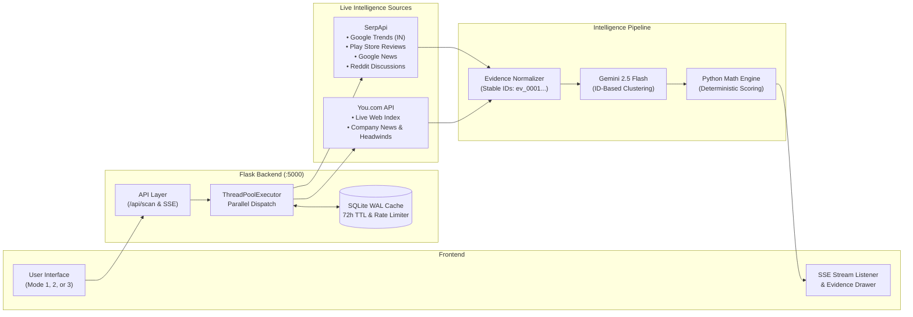

<div align="center">

# GapScope

**Market Intelligence Where Every Insight Shows Its Source.**

[](https://www.python.org/)
[](https://flask.palletsprojects.com/)
[](https://ai.google.dev/)
[](https://serpapi.com/)
[](https://you.com/)
[](https://sqlite.org/)

An autonomous market-intelligence engine that investigates startup concepts, companies, and industry sectors against real-world customer evidence and search momentum. Built for the **Beyond 9to5 Buildathon** (Track 01: SerpApi & Track 02: You.com).

</div>

---

## Product Preview

<div align="center">

### Research Workspace & Scan Hub


<br/><br/>

| Market Intelligence Report & Viability Score | Live Evidence Wall & Customer Receipts |
|:---:|:---:|
|  |  |

</div>

---

## Architecture & Workflow



---

## What GapScope Does

Traditional AI idea validators generate generic SWOT analyses and unverified claims without citing where the feedback came from. **GapScope eliminates hallucination by construction**: every pain point, trend direction, and opportunity links directly to an immutable evidence citation from the public web.

The engine provides three focused research modes:

### 1. Validate My Idea
> *"I have an idea. Is there a real opportunity?"*
- Deconstructs concepts into broad search keywords and specific competitor queries.
- Pulls 1★–3★ critical Play Store reviews across incumbents alongside 12-month Google Trends search momentum.
- Computes a deterministic **Viability Score (0–100)** with a concrete verdict:
  - **`BUILD`** ($\ge 65$): High customer pain, rising demand, and clear room for incumbent disruption.
  - **`PIVOT`** ($40-64$): Moderate validation; needs positioning or differentiation adjustments.
  - **`KILL`** ($< 40$): Low search demand, satisfied incumbents, or weak customer friction signals.
- Generates 3 evidence-backed differentiation vectors tied directly to customer pain clusters.

### 2. Investigate a Business
> *"Why is this business succeeding or failing?"*
- Evaluates a specific company, startup, or product across public sentiment and web coverage.
- Compares 1★ vs. 5★ user reviews, assesses 90-day review sentiment drift against all-time ratings, and analyzes media sentiment.
- Determines a net trajectory verdict: **`GROWING`**, **`STAGNATING`**, or **`DECLINING`**.
- Outlines operational strain points and strategic opportunities for incoming competitors.

### 3. Discover an Opportunity
> *"I don't have an idea. Find something worth building."*
- Analyzes an entire category (*Personal Finance, FinTech, EdTech, Healthcare, Quick-commerce, Travel, Mental Health, Agritech, Other*).
- Scans top benchmark applications and detects **cross-app systemic gaps**—frustrations that repeat across multiple competitors.
- Formulates 3 concrete startup blueprints with designated target personas and verified evidence references.

---

## Key Features

- **Anti-Hallucination Evidence Core**: Every review, forum post, and article snippet is normalized with a permanent sequential ID (`ev_0001`...). Gemini clusters feedback solely by ID and never paraphrases or generates synthetic quotes.
- **Deterministic Python Scoring**: Viability scores and trajectory verdicts are computed via transparent mathematical formulas across measured signals (search interest slope, review decay, competition gap)—never by arbitrary LLM text generation.
- **Live Server-Sent Events (SSE)**: Real-time scan progression streams milestones directly to the UI, providing complete transparency into data retrieval, clustering, and scoring phases.
- **Evidence Drawer & Citations**: Interactive slide-over vault displaying raw quotes, star ratings, review timestamps, authors, and verified outbound URLs.
- **Offline Demo Mode & Cache**: Thread-safe SQLite database (WAL mode) with `sha256` parameter hashing, sliding-window rate limiting (45 calls/hr), and a pre-warmed cache enabling zero-latency, zero-credit presentations.

---

## Tech Stack

| Component | Technologies |
|---|---|
| **Frontend** | HTML5, Vanilla JavaScript (ES Modules), Tailwind CSS, Chart.js, Google Fonts (Inter, Newsreader, JetBrains Mono) |
| **Backend** | Python 3.11+, Flask 3.1, flask-cors, `concurrent.futures.ThreadPoolExecutor` |
| **AI / Clustering** | Google Gemini 2.5 Flash (`google-genai` SDK, structured JSON output) |
| **Data Providers** | **SerpApi** (Google Trends, Play Store, Google News, Reddit), **You.com** (Search API, Web Index & News) |
| **Storage & Caching** | SQLite3 (Write-Ahead Logging mode), SHA-256 query hashing, 72-hour TTL |

---

## Getting Started

### Prerequisites
- Python 3.11+
- API Keys:
  - [SerpApi API Key](https://serpapi.com/)
  - [You.com Search API Key](https://you.com/)
  - [Google Gemini API Key](https://aistudio.google.com/)

---

### 1. Clone the Repository

```bash
git clone https://github.com/Vivekh22/Paytm_Beyond_API.git
cd Paytm_Beyond_API
```

---

### 2. Backend Setup

```bash
cd backend

# Create and activate virtual environment
python -m venv venv
# On Windows:
venv\Scripts\activate
# On Linux/macOS:
source venv/bin/activate

# Install dependencies
pip install -r requirements.txt

# Configure environment variables
cp .env.example .env
```

Edit `.env` with your API keys:
```env
SERPAPI_KEY=your_serpapi_key_here
YDC_API_KEY=your_youcom_api_key_here
GEMINI_API_KEY=your_gemini_api_key_here

# Optional configuration
DEMO_MODE=0
SERPAPI_HOURLY_LIMIT=45
SERPAPI_SCAN_BUDGET=8
PORT=5000
```

Start the Flask server:
```bash
python app.py
```
*The backend runs at `http://localhost:5000`.*

---

### 3. Demo Prewarming & Offline Mode

To populate the local SQLite cache with preset demo queries ahead of judging or offline presentations:

```bash
# Dry run to inspect call budget
python prewarm.py --dry-run

# Run full prewarming across presets
python prewarm.py
```

Set `DEMO_MODE=1` in `.env` to execute fully offline using pre-cached responses without hitting external API limits.

---

### 4. Run the Frontend

Open `frontend/index.html` via any static file server:

```bash
# From the project root
python -m http.server 3000 --directory frontend
```
*Navigate to `http://localhost:3000` in your browser.*

---

## Project Structure

```
├── backend/
│   ├── app.py                 # Flask server, SSE streaming, and REST endpoints
│   ├── cache.py               # Thread-safe SQLite WAL caching & sliding-window limiter
│   ├── config.py              # Configuration loader & environment settings
│   ├── evidence.py            # Evidence normalizer & anti-hallucination ID mapping
│   ├── llm.py                 # Gemini 2.5 Flash clustering & opportunity generation
│   ├── pipelines.py           # Multi-threaded execution pipelines for Modes 1, 2, and 3
│   ├── prewarm.py             # Demo cache prewarmer for offline presentations
│   ├── scoring.py             # Deterministic Python math formulas for Viability & Trajectory
│   ├── serp_client.py         # SerpApi client wrappers (Trends, Play Store, News, Reddit)
│   ├── youcom_client.py       # You.com Search API integration
│   ├── mock/                  # Shared JSON mock reports (Modes 1, 2, and 3)
│   └── requirements.txt       # Backend dependencies
├── frontend/
│   ├── index.html             # Main research workspace & report container
│   ├── report.html            # Standalone shareable report view
│   ├── css/
│   │   └── gapscope.css       # Custom styling & animations
│   ├── js/
│   │   ├── api.js             # Client API service & Server-Sent Events stream consumer
│   │   ├── app.js             # Application state, mode switching & event handlers
│   │   ├── charts.js          # Chart.js trend curves & viability score gauges
│   │   ├── config.js          # Client configuration, demo presets & source meta
│   │   ├── render.js          # Modular HTML rendering for reports, clusters & evidence
│   │   └── tw-config.js       # Tailwind theme extensions
│   └── mock/                  # Client-side offline fallback mock datasets
├── 01_PROBLEM_STATEMENT.md    # Hackathon problem statement & design principles
├── 02_BACKEND_PROMPT.md       # Backend architecture specifications
├── 03_FRONTEND_PROMPT.md      # Frontend architecture specifications
├── MEMORY.md                  # Project memory & engineering decisions
└── README.md                  # Project documentation
```

---

## Important Notes

- **API Rate Limits**: The backend enforces an in-memory sliding-window limiter (`SERPAPI_HOURLY_LIMIT=45`) to safeguard account quotas during testing.
- **Decision Support**: Viability scores and trajectory verdicts represent algorithmic signals based on sampled public feedback and search volume; they serve as decision-support metrics rather than commercial guarantees.
- **Offline Reliability**: With `DEMO_MODE=1` or `USE_MOCK=true`, all three modes operate with zero network latency, ensuring dependable demonstrations even without an active internet connection.

---

<div align="center">
  <sub>Built for the Beyond 9to5 Buildathon · Bengaluru, 2026</sub>
</div>
