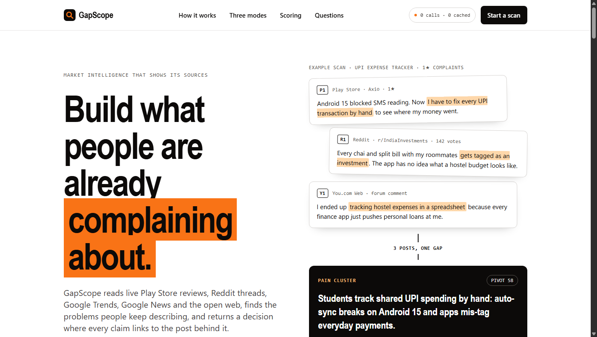
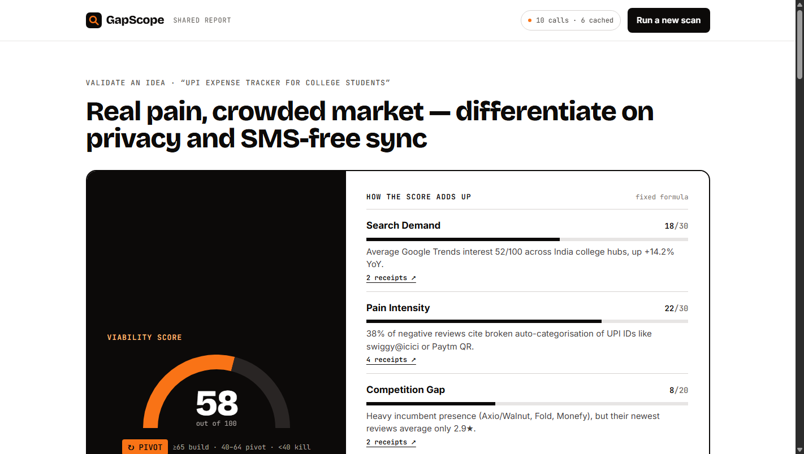
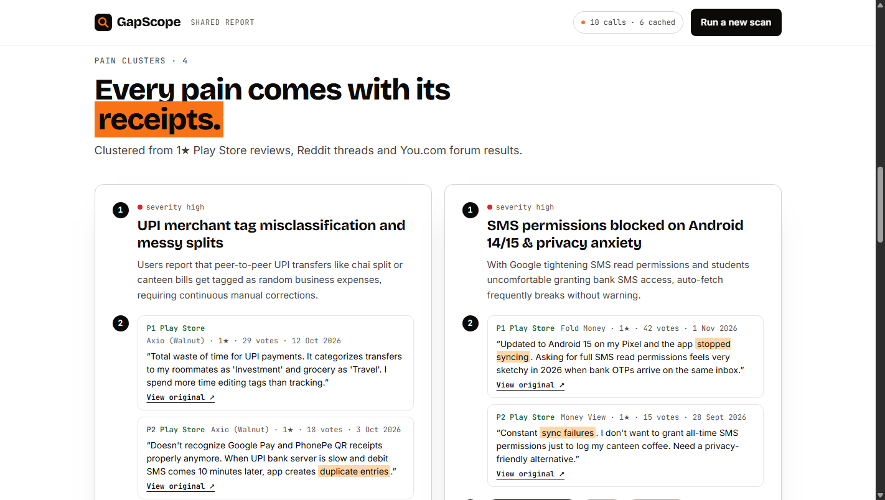
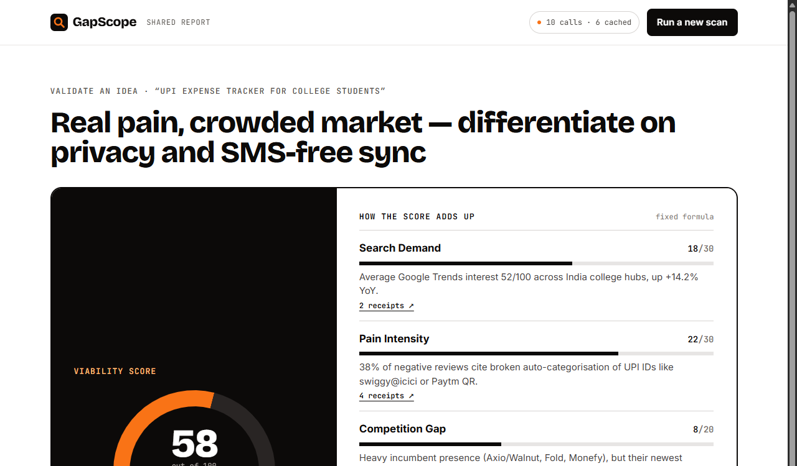
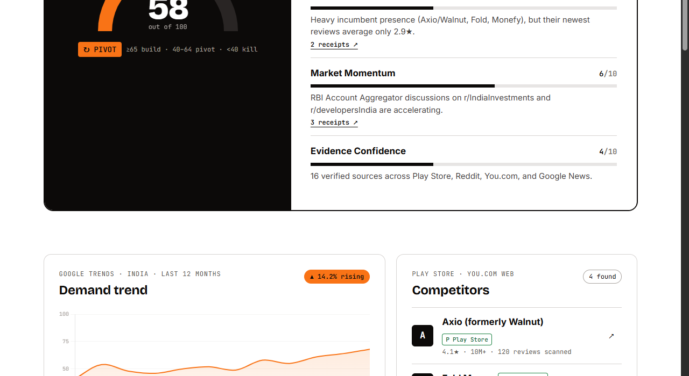
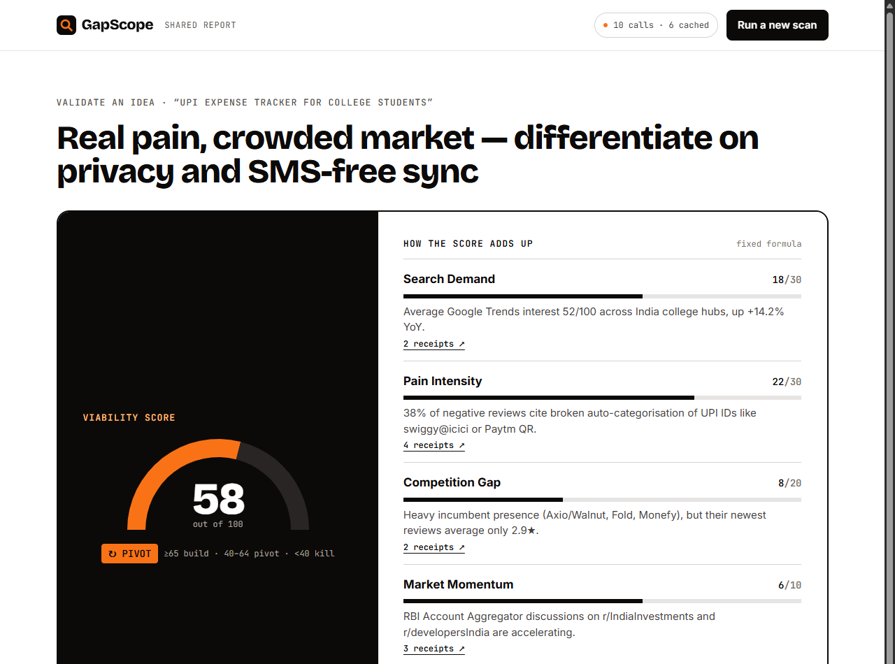
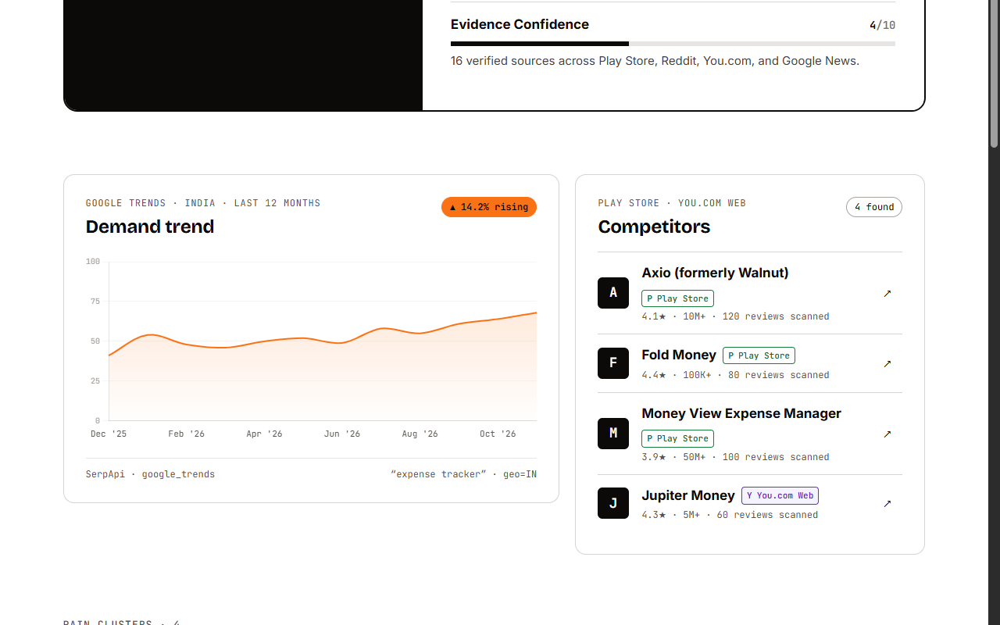
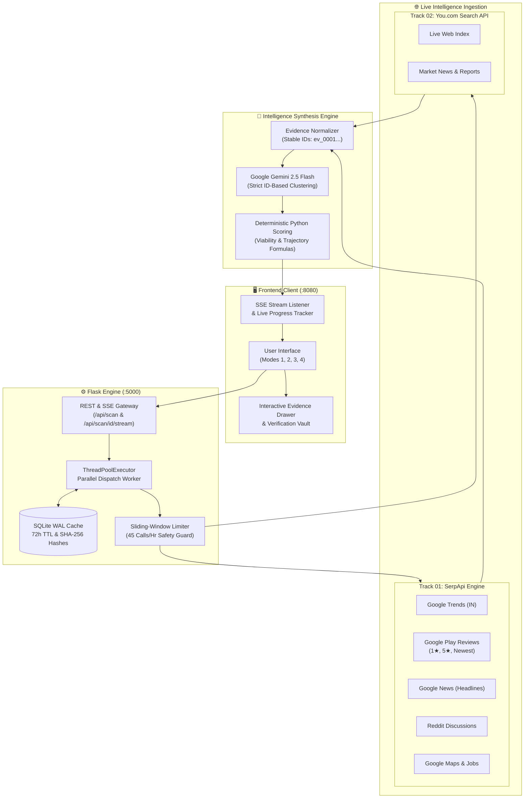

<div align="center">

# 🔭 GapScope

### **Autonomous Market Intelligence Engine Where Every Claim Links to Its Receipts.**

Built for the **Beyond 9 to 5 Buildathon**  
*Dual-Track Winner Contender: Track 01 (SerpApi) & Track 02 (You.com)*

[](https://www.python.org/)
[](https://flask.palletsprojects.com/)
[](https://ai.google.dev/)
[](https://serpapi.com/)
[](https://you.com/)
[](https://sqlite.org/)
[](https://tailwindcss.com/)

<br/>

[Live Demo](#-product-showcase) • [Architecture](#-system-architecture) • [Core Modes](#-four-intelligence-modes) • [Tech Stack](#-tech-stack) • [Quickstart](#-getting-started) • [API Docs](#-api-endpoints)

</div>

---

## 💡 The Problem & GapScope's Solution

<<<<<<< HEAD
| The Traditional AI Trap | The GapScope Way |
|---|---|
| ❌ **Hallucinated Market Data:** LLMs invent user feedback, competitor metrics, and synthetic quotes. | ✅ **Zero-Hallucination Evidence Core:** Every review, forum thread, and article snippet is assigned an immutable ID (`ev_0001`...). AI clusters by ID only—never paraphrasing or inventing quotes. |
| ❌ **Black-Box "Vibes" Scoring:** "7/10 market viability" generated from arbitrary prompt completions. | ✅ **Deterministic Python Math Engine:** Transparent mathematical formulas calculate Demand, Pain Intensity, Competition Gap, and Momentum (0–100 scale). |
| ❌ **Static & Stale Snapshots:** Reports reflect outdated training data cutoff dates. | ✅ **Multi-Source Live Intelligence:** Real-time data synthesis across Google Trends, Play Store reviews, Reddit discussions, Google News, and You.com Web Index. |
| ❌ **No Impersonation Defense:** Startups and brands are defenseless against fake apps, scam helplines, and lookalike domains. | ✅ **Integrated Brand Protect (Mode 4):** Autonomous scam, fake job listing, and lookalike portal detection with one-click takedown text and public verification pages. |
=======
<div align="center">

### Research Workspace & Scan Hub


<br/><br/>

| Market Intelligence Report & Viability Score | Live Evidence Wall & Customer Receipts |
|:---:|:---:|
|  |  |

</div>
>>>>>>> 5ce1897d8585ee76b386f016b9a1667d4ea77893

---

## 📸 Product Showcase

### 1. Research Workspace & Scan Hub
> Full-viewport interactive workspace supporting single-click demo presets, customizable search queries, and dynamic mode routing.

<div align="center">
  
</div>

<br/>

### 2. Live Intelligence Reports & Deep Insights
> Interactive intelligence views featuring deterministic score gauges, 12-month Google Trends curves, verified customer receipts, and actionable startup blueprints.

<table width="100%">
  <tr>
    <td width="50%" align="center" valign="top">
      <h4>🎯 01 · Viability Score & Math Breakdown</h4>
      
      <p align="left"><sub><b>Deterministic Verdict:</b> Concrete <b>BUILD</b> (≥65), <b>PIVOT</b> (40–64), or <b>KILL</b> (&lt;40) verdicts with mathematical factor attribution.</sub></p>
    </td>
    <td width="50%" align="center" valign="top">
      <h4>📈 02 · 12-Month Demand Trend & Competitors</h4>
      
      <p align="left"><sub><b>Market Momentum:</b> Real-time Google Trends search slope across India anchored against baseline benchmarks and competitor app ratings.</sub></p>
    </td>
  </tr>
  <tr>
    <td width="50%" align="center" valign="top">
      <h4>💬 03 · Verbatim Customer Friction Wall</h4>
      
      <p align="left"><sub><b>Evidence with Receipts:</b> Unfiltered 1★ Play Store complaints, Reddit discussions, and You.com forum findings with direct outbound links.</sub></p>
    </td>
    <td width="50%" align="center" valign="top">
      <h4>🚀 04 · Strategic Opportunities & Blueprints</h4>
      
      <p align="left"><sub><b>Actionable Whitespace:</b> AI-synthesized product concepts pointing directly to the exact customer pain clusters they resolve.</sub></p>
    </td>
  </tr>
</table>

---

## 🏛️ System Architecture



---

## ⚡ The Four Intelligence Modes

### Mode 01: Validate an Idea
> *"I have an idea. Is there a genuine market opportunity?"*
- **Deconstructs Concepts:** Gemini extracts macro trend keywords alongside direct incumbent competitor terms.
- **Synthesizes Signals:** Computes a **0–100 Viability Score** using deterministic weights:
  - **Demand (30 pts):** Google Trends search interest slope and volume relative to an anchor keyword.
  - **Pain Intensity (30 pts):** Frequency and severity of recurring 1★ reviews and critical forum complaints.
  - **Competition Gap (20 pts):** Average incumbent star rating decay and feature dissatisfaction.
  - **Momentum (10 pts):** Trailing 90-day sentiment in tech press and business news.
  - **Evidence Confidence (10 pts):** Review depth across multiple independent source families.
- **Actionable Verdict:** Concrete recommendation: **`BUILD`** ($\ge 65$), **`PIVOT`** ($40-64$), or **`KILL`** ($< 40$).

### Mode 02: Investigate a Business
> *"Why is this incumbent company winning or bleeding users?"*
- **Trajectory Diagnosis:** Analyzes review drift (trailing 90-day ratings vs. all-time store average), search interest trajectory, and news sentiment.
- **Net Verdict:** Classifies business momentum into **`GROWING`**, **`STAGNATING`**, or **`DECLINING`**.
- **User Love vs. Hate Matrix:** Side-by-side clustering comparing 1★ churn drivers against 5★ loyalty factors.

### Mode 03: Discover an Opportunity
> *"I have no startup idea. Discover an underserved category gap."*
- **Category Benchmarking:** Evaluates top incumbents across categories (*FinTech, EdTech, Healthcare, Quick-commerce, Agritech, etc.*).
- **Cross-App Systemic Whitespace:** Uncovers recurring pain points shared across 2 or more competitor applications.
- **3 Differentiated Blueprints:** Formulates full startup product concepts, target customer personas, and direct citations to the market frustrations being solved.

### Mode 04: Brand Protect & Anti-Fraud
> *"Is someone impersonating our brand, running fake job posts, or scamming customers?"*
- **Autonomous Scan:** Queries Google Search, Google Maps, Google Jobs, Google Play Store, and News for brand impersonation.
- **Severity Flagging:** Identifies fraudulent customer support numbers, fake hiring scams asking for application fees, and lookalike phishing domains.
- **One-Click Action:** Generates pre-formatted takedown notice text for registries/hosts and publishes a public verified channels directory (`/verified/<brand>`).

---

## 🛠️ Tech Stack & Dependencies

| Category | Technologies | Description |
|---|---|---|
| **Backend Framework** |  Python 3.11+, Flask 3.1, `flask-cors` | Asynchronous SSE streaming API and parallel worker dispatcher |
| **Concurrency & Cache** |  `ThreadPoolExecutor`, SQLite3 (WAL mode) | Multi-threaded network calls with 72h TTL caching and SHA-256 hashing |
| **AI & NLP Engine** |  Google Gemini 2.5 Flash (`google-genai` 3.6+) | Zero-hallucination, ID-based sentiment clustering and keyword extraction |
| **Track 01: SerpApi** | SerpApi Python Integration | Google Trends (geo=IN), Play Store Reviews, Google News, Google Maps, Jobs |
| **Track 02: You.com** | You.com Search API (`ydc-index.io`) | Live web index, competitor discovery, forum discussions, and market reports |
| **Frontend Architecture** |  HTML5, ES Modules, Tailwind CSS | Responsive, zero-build, dependency-light modern UI |
| **Data Visualizations** | Chart.js 4.4 | Smooth demand interest curves and half-circle viability gauges |

---

## 🚀 Getting Started

### 📋 Prerequisites
- Python 3.11 or higher
- API Keys:
  - [Google Gemini API Key](https://aistudio.google.com/)
  - [SerpApi Account Key](https://serpapi.com/) *(Track 01)*
  - [You.com Search API Key](https://you.com/) *(Track 02)*

---

### 1. Clone the Repository

```bash
git clone https://github.com/Vivekh22/Paytm_Beyond_API.git
cd Paytm_Beyond_API
```

---

### 2. Configure Environment

Copy `.env.example` to `.env` inside the `backend` directory:

```bash
cd backend
cp .env.example .env
```

Edit `backend/.env` with your API keys:

```env
# GapScope API Keys
SERPAPI_KEY=your_serpapi_key_here
YDC_API_KEY=your_youcom_api_key_here
GEMINI_API_KEY=your_gemini_api_key_here

# Mode & Safety Controls
DEMO_MODE=0
SERPAPI_HOURLY_LIMIT=45
SERPAPI_SCAN_BUDGET=8
PORT=5000
TRENDS_ANCHOR=credit card
```

---

### 3. Install Dependencies & Start Backend

```bash
# Recommended: Create virtual environment
python -m venv venv
# Windows:
venv\Scripts\activate
# Linux/macOS:
source venv/bin/activate

# Install requirements
pip install -r requirements.txt

# Start Flask server
python app.py
```
*Backend runs on `http://localhost:5000` with open CORS enabled.*

---

### 4. Start Frontend

In a separate terminal, serve the frontend folder via any static server:

```bash
cd Paytm_Beyond_API/frontend
python -m http.server 8080
```
*Open your browser and navigate to **`http://localhost:8080`**.*

---

### 5. Offline Demo Prewarming (Zero Latency)

To populate the local SQLite database ahead of judging presentations or pitch demos:

```bash
cd backend

# Inspect quota budget without triggering API calls
python prewarm.py --dry-run

# Run full prewarm across all demo presets
python prewarm.py
```

Set `DEMO_MODE=1` in `backend/.env` to run 100% offline using cached reports with zero credit usage and instant response times!

---

## 📡 API Endpoints

| Method | Endpoint | Description |
|---|---|---|
| `GET` | `/api/health` | Returns cache telemetry, quota utilization, and demo mode status |
| `GET` | `/api/examples` | Retrieves standard demo presets with cache indicators |
| `POST` | `/api/scan` | Initiates scan (`{"mode": 1\|2\|3\|4, "query": "..."}`) and returns `scan_id` |
| `GET` | `/api/scan/<id>/stream` | Server-Sent Events (SSE) progress milestones and final report payload |
| `GET` | `/api/report/<id>` | Retrieves completed report for permalinks and PDF exports |
| `GET` | `/api/compare?a=<id>&b=<id>` | Side-by-side competitor intelligence comparison (Mode 2) |
| `GET` | `/verified/<brand>` | Public shareable registry displaying verified official company channels |

---

## 📁 Repository Structure

```
Paytm_Beyond_API/
├── assets/
│   └── screenshots/              # Real UI screenshots for GitHub preview
│       ├── landing-hero.png      # Hero section & workspace
│       ├── section1-verdict.png  # Viability score gauge & breakdown
│       ├── section2-demand-trend.png # Google trends & competitor metrics
│       ├── section3-evidence-clusters.png # Verbatim customer friction wall
│       └── section4-opportunities.png # Strategic blueprints & solutions
├── backend/
│   ├── app.py                    # Flask application, SSE event stream & REST routing
│   ├── cache.py                  # Thread-safe SQLite WAL caching & sliding-window limiter
│   ├── config.py                 # Configuration loader & environment variables
│   ├── evidence.py               # Anti-hallucination sequential ID normalizer
│   ├── llm.py                    # Gemini 2.5 Flash structured JSON clustering
│   ├── pipelines.py              # Parallel execution pipelines (Modes 1, 2, 3)
│   ├── protect.py                # Mode 4 Brand Protect & scam detection engine
│   ├── scoring.py                # Deterministic Python mathematical scoring formulas
│   ├── serp_client.py            # SerpApi client (Trends, Play Store, News, Reddit, Maps, Jobs)
│   ├── youcom_client.py          # You.com Search API client & web intelligence
│   ├── prewarm.py                # Demo preset prewarmer for offline presentations
│   ├── monitor.py                # Scheduled background watch & monitoring service
│   ├── notify.py                 # Automated Telegram alert dispatcher
│   ├── compare.py                # Competitor side-by-side comparison utility
│   ├── mock/                     # Offline contract mock datasets
│   └── requirements.txt          # Python dependencies
├── frontend/
│   ├── index.html                # Main research application & interactive hub
│   ├── report.html               # Dedicated shareable report viewer
│   ├── css/gapscope.css          # Design system styling & custom animations
│   ├── js/
│   │   ├── app.js                # State machine, mode switching & event orchestrator
│   │   ├── api.js                # SSE client & API communication layer
│   │   ├── charts.js             # Chart.js trend curves & viability score gauges
│   │   ├── config.js             # Configuration, demo presets & source styling
│   │   └── render.js             # XSS-safe HTML rendering engine for reports & clusters
│   └── mock/                     # Client-side offline fallback mock datasets
├── 01_PROBLEM_STATEMENT.md       # Hackathon problem statement & design principles
├── MEMORY.md                     # Engineering decision records
└── README.md                     # Project documentation
```

---

## 🛡️ Guardrails & Engineering Moats

1. **Anti-Hallucination Core:** Raw user feedback is mapped into sequential IDs (`ev_0001`...). Gemini is prompted to group exclusively by ID. Post-validation strips any references without direct proof.
2. **Quota Protection:** An in-memory sliding-window limiter prevents account quota exhaustion (`SERPAPI_HOURLY_LIMIT=45`, `SERPAPI_SCAN_BUDGET=8`).
3. **Deterministic Math:** Viability scores and trajectory verdicts are calculated entirely in Python—guaranteeing reproducibility, auditability, and mathematical integrity.

---

<div align="center">

**Built with ❤️ for the Beyond 9 to 5 Buildathon**  
*Track 01 (SerpApi) & Track 02 (You.com)*

<sub>© 2026 GapScope Team. Open-source under the MIT License.</sub>

</div>
