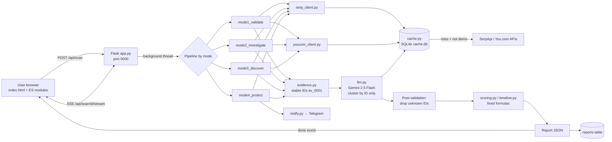

# GapScope: Study Guide for the Viva

Everything about the project in one place: what it is, why it exists, how every part works, the database, the formulas, the APIs, the limits, and the questions judges are likely to ask.
Prepared 21 Nov 2026 · Beyond 9TO5 Buildathon, Bengaluru · Track 01 SerpApi + Track 02 You.com

---

## 0. How to use this file

1. Learn **Section 1** (the 30-second pitch) word for word.
2. Be able to draw **Section 4** (the architecture) on a whiteboard from memory.
3. Know the **formulas in Section 9** and the **anti-hallucination rule in Section 8**. Judges ask about these most.
4. Read **Section 16** (honest limitations) so no question surprises you.
5. Practise **Section 18** (likely questions) out loud.

---

## 1. The 30-second pitch

> Founders decide what to build on gut feel, or from AI "idea validators" that invent competitors and pain points without citing anything. GapScope reads live public evidence (Play Store reviews, Google Trends, Google News, Reddit, Maps, Jobs and the open web through SerpApi and You.com), groups what people complain about, and returns a **decision with receipts**: every claim links to the review, post or article behind it, and every score comes from a fixed formula, not an AI's opinion. It has four modes: **Validate** an idea, **Investigate** a business, **Discover** an opportunity, and **Protect** a brand from people impersonating it.

One-line version: **"Market intelligence that shows its sources."**

---

## 2. The problem (with evidence)

| Problem | Evidence |
|---|---|
| Startups build things nobody needs | CB Insights' analysis of 111 startup post-mortems: "no market need" was a cause in **35%** of failures (second only to running out of cash, 38%). An older 2014 CB Insights study of 101 post-mortems put it at 42%. |
| Research takes hours or days | Reading hundreds of reviews and cross-checking trends and news by hand. |
| Existing AI validators can't be checked | Most validators (IdeaProof, ValidatorAI, Ideation.biz and others) judge ideas in the abstract. A 2026 comparison of 9 tools said only one (Preuve AI) cites live sources for every claim. |
| Brands get impersonated (Protect mode) | Seqrite reports brand impersonation attacks in India rose **over 300%** between 2024 and 2025. I4C says Indians lost about **₹7,000 crore in Jan–May 2025** to scams run from Southeast Asia, with job and task scams among the main types. AICTE (Jan 2025) warned colleges about fake appointment letters in its name. |

---

## 3. The solution: four modes

| Mode | Question it answers | Input | Output |
|---|---|---|---|
| **1 · Validate** | "I have an idea. Is there a real opportunity?" | Free-text idea | **Viability Score 0–100 → BUILD / PIVOT / KILL**, competitors, complaint clusters, Indian regions, 2–3 ways to stand out |
| **2 · Investigate** | "Why is this business winning or losing?" | Company / app name | **GROWING / STAGNATING / DECLINING**, what users hate vs love, **month-by-month timeline with turning points**, what a challenger should do, **Compare** with another business |
| **3 · Discover** | "I don't have an idea. Find something worth building." | Category | Complaints that repeat **across** the top 5 apps, **underserved needs**, 3 startup concepts |
| **4 · Protect** | "Who is pretending to be us?" | Brand + optional official records | **Suspected** fake helplines, job posts, look-alike sites, apps, Telegram/WhatsApp groups, scam news, each with evidence and report text |

Business logic: modes 1–3 are free research for founders. Mode 4 is the paid product for organisations. Founders discover → validate → study who failed → launch → protect the brand.

---

## 4. Architecture

### 4.1 High-level diagram



### 4.2 Same thing as a whiteboard sketch

```
Browser ──POST /api/scan──► Flask ──thread──► Pipeline (mode 1/2/3/4)
   ▲                                              │
   │ SSE progress + final report                  ├─► SerpApi client ─┐
   │                                              ├─► You.com client ─┼─► SQLite cache ─► (miss) live API
   │                                              ├─► Evidence collector (IDs, dedupe, cap)
   │                                              ├─► Gemini (groups by ID, cached) ─► validator drops fake IDs
   │                                              ├─► Python scoring / timeline / protect rules
   └──────────────────────────────────────────────┴─► Report JSON ─► reports table
```

### 4.3 Request lifecycle (step by step)

1. User picks a mode and types a query; the frontend calls `POST /api/scan {mode, query, official?}`.
2. Flask creates a `ScanSession`, returns `{scan_id}` (HTTP 202) and starts a **background thread**.
3. Browser opens `GET /api/scan/<scan_id>/stream` (**Server-Sent Events**).
4. The pipeline runs. Searches run **in parallel** (`ThreadPoolExecutor`, up to 8 workers). Every call goes through the **cache**.
5. After each step the pipeline emits `{"type":"progress","step","message","pct"}`. The SSE stream sends it to the browser, which shows a live progress timeline.
6. Raw results become **evidence items** with stable IDs.
7. Gemini groups evidence into themes, **referencing IDs only**. The backend deletes any ID that doesn't exist.
8. Python computes scores, the trajectory, the timeline or the Protect findings with **fixed rules**.
9. The report is saved to the `reports` table and sent as `{"type":"done","report":{...}}`.
10. The frontend renders the verdict, charts, receipt cards and the evidence drawer.

### 4.4 Demo mode flow (no internet)

`DEMO_MODE=1` → the cache never calls the network. If a saved report exists for the same (mode, query), the server **replays** it with a short progress stream. `prewarm.py` fills the cache and saves those reports beforehand.

---

## 5. Tech stack and why each was chosen

| Layer | Technology | Why |
|---|---|---|
| Backend language | **Python 3.11+** (team runs 3.14 on Windows) | Fast to write, great HTTP and data libraries |
| Web framework | **Flask 3** + **flask-cors** | Minimal, enough for 10 routes, easy SSE with generators |
| Concurrency | `threading` + `concurrent.futures.ThreadPoolExecutor` | Searches are I/O-bound; threads run them in parallel |
| Live updates | **Server-Sent Events (SSE)** | One-way server → browser stream, simpler than WebSockets, works with plain `EventSource` |
| Database | **SQLite** (stdlib `sqlite3`, WAL mode) | Zero setup, one file, safe for concurrent readers, perfect for caching and demo replay |
| Data APIs | **SerpApi** (Track 01), **You.com Search API** (Track 02) | Structured live search data; You.com covers the open web and businesses without apps |
| AI | **Google Gemini 2.5 Flash** via `google-genai` SDK | Fast, cheap, JSON output mode. Used **only** to extract keywords, group evidence and name groups |
| HTTP | `requests` | Simple, timeouts, reliable |
| Config | `python-dotenv` (`.env`) | Keys and settings out of code |
| Alerts | Telegram Bot API (via `requests`) | Free, instant, no app to build |
| Frontend | **HTML + Tailwind CSS (CDN) + vanilla JS ES modules**, no build step | Opens with any static server, nothing to compile on the day |
| Charts | **Chart.js 4.4.1** | Gauge, trend line, timeline (mixed bar + line, three axes) |
| Fonts | Bricolage Grotesque (display), Inter (body), JetBrains Mono (meta) | Editorial "research report" look inspired by finprob.com |
| Tests | `unittest` + `unittest.mock` | No extra dependency; all external APIs mocked |

---

## 6. Folder and file map (what every file does)

```
Paytm_Beyond_API/
├─ 01_PROBLEM_STATEMENT.md   02_BACKEND_PROMPT.md   03_FRONTEND_PROMPT.md   MEMORY.md
├─ STUDY_FOR_VIVA.md          ← this file
├─ backend/
│  ├─ app.py               Flask routes, ScanSession, SSE stream, demo replay, Protect endpoints, /verified page
│  ├─ config.py            Reads .env: keys, DEMO_MODE, limits, thresholds, anchor term, Telegram, Extract settings
│  ├─ cache.py             SQLite: cache, reports, brand_official, protect_allow, protect_seen; rate limiter
│  ├─ serp_client.py       All SerpApi engines (Trends, Play, Play reviews, News, Reddit, Google, Maps, Maps reviews,
│  │                       Jobs, App Store, Extract) with defensive parsing
│  ├─ youcom_client.py     You.com web/news search
│  ├─ evidence.py          EvidenceCollector: normalise, dedupe, cap, stable IDs
│  ├─ llm.py               Gemini calls (cached), keyword extraction, clustering, opportunities, news sentiment,
│  │                       post-validation, interleaved sampling, error tracking
│  ├─ scoring.py           Viability score, trajectory, discovery verdict, trend maths, date parser
│  ├─ timeline.py          Mode 2 month-by-month timeline + turning points
│  ├─ pipelines.py         mode1_validate, mode2_investigate, mode3_discover, CreditTracker
│  ├─ protect.py           mode4_protect: detectors, official-record matching, auto-detected numbers, allowlist
│  ├─ compare.py           Side-by-side summary of two Mode 2 reports
│  ├─ notify.py            Telegram alert (new findings only)
│  ├─ monitor.py           Scheduled Protect re-scans (loop or --once)
│  ├─ prewarm.py           Runs all 11 presets to fill the cache and save reports; --dry-run estimates calls
│  ├─ check_contract.py    Validates any report against the JSON contract
│  ├─ check_gemini.py      One-line Gemini key test
│  ├─ test_suite.py, test_new_features.py, test_more_features.py   26 tests in total
│  ├─ mock/report_mode{1,2,3}.json   sample reports (marked "sample": true)
│  ├─ .env / .env.example  keys and settings (.env is git-ignored)
│  └─ cache.db             SQLite database (git-ignored)
└─ frontend/
   ├─ index.html           Landing + scan box (4 mode tabs) + results area + evidence drawer
   ├─ report.html          Share-link page: loads /api/report/<id>
   ├─ css/gapscope.css, js/tw-config.js   styles and Tailwind config
   └─ js/
      ├─ config.js         API_BASE (same host, port 5000), USE_MOCK=false, fallback presets, source tag colours
      ├─ api.js            startScan, streamScan (EventSource), getReport, getExamples, allowFinding, getCompare
      ├─ app.js            State, mode switching, hash routes (#validate…#protect), progress, report wiring,
      │                    drawer, compare flow, findings actions
      ├─ render.js         Pure functions: JSON → escaped HTML (verdict, receipts, timeline, regions, compare, findings)
      └─ charts.js         Score gauge, trend line, timeline chart
```

---

## 7. Database (SQLite `cache.db`)

WAL mode (`PRAGMA journal_mode=WAL`), a new connection per call (thread-safe), `check_same_thread=False`.

| Table | Columns | Purpose |
|---|---|---|
| `cache` | `key` PK, `provider`, `engine`, `params`, `response`, `created_at` | Every SerpApi, You.com and **Gemini** response. TTL 72 hours. |
| `reports` | `scan_id` PK, `mode`, `query`, `report` (JSON), `created_at` | Every finished report: share links, demo replay, Compare |
| `brand_official` | `brand` PK, `official` (JSON), `watch`, `interval_hours`, `last_run` | Protect: official websites, numbers, app IDs; scheduler settings |
| `protect_allow` | `brand`, `type`, `value`, `created_at` (PK brand+type+value) | Items the brand marked as genuine ("It's ours") |
| `protect_seen` | `brand`, `type`, `value`, `first_seen` (PK brand+type+value) | History, so alerts fire only for **new** findings |

**Cache key** = `sha256(provider + ":" + engine + ":" + json.dumps(params without api keys, sort_keys=True))`. Same request → same key → served from cache, at no cost.

**Gemini cache key** = `model + sha256(prompt)`. This matters because Gemini's output can vary: without caching, different keywords would mean different SerpApi keys and cache misses in demo mode.

**Rate limiting:** an in-memory sliding window allows at most **45 live SerpApi calls per hour** (headroom under the free plan's 50). Each scan aims for ≤ 8 calls. The Trends fallback retry is skipped if it would break that budget.

---

## 8. Anti-hallucination design (the core idea, explain this well)

1. Every raw item becomes an **evidence item** with a stable ID (`ev_0001` …), its verbatim text (trimmed to 400 characters), source, author, rating, date, URL and entity.
2. Gemini receives items as `[ev_0007] (play_store, 1★) text…` and must return **IDs only**: "Reference evidence ONLY by ID. Never write or paraphrase quotes."
3. **Post-validation:** the backend removes every ID not in the evidence pool. `frequency.count` = the number of valid IDs. If none remain, the cluster is marked **AI-suggested** and shows no quotes.
4. **Quotes on screen always come from the evidence pool**, never from Gemini's text.
5. **Scores are plain Python formulas** over measured signals. Gemini never produces a number.
6. If Gemini fails, clusters and opportunities come back **empty** (no invented template themes), and the page shows a "Themes unavailable" card plus a warning.
7. `check_contract.py` verifies that every evidence ID anywhere in a report exists in `report.evidence`.

---

## 9. Formulas and rules (know these numbers)

### 9.1 Mode 1: Viability Score (0–100)

| Factor | Max | Formula |
|---|---|---|
| **Demand** | 30 | Trends fetched as `"<keyword>,credit card"` in one request. `ratio = mean(keyword) / mean(anchor)`, capped at 1 → `ratio × 20` + slope bonus (**+10 rising, +5 flat, 0 falling**). Rising/falling = last quarter of the 12-month series vs the first three quarters, ±5%. No Trends data → 0. |
| **Pain intensity** | 30 | Share of the items Gemini analysed that fall into the **top 3 complaint clusters** × 30 |
| **Competition gap** | 20 | `(5 − average competitor rating) / 2 × 20`, capped. No ratings → neutral 10 (not counted as an open market). |
| **Momentum** | 10 | News items **dated within the last 90 days** × 10 / 8, capped at 10. Undated items are ignored. |
| **Evidence confidence** | 10 | `min(4, app reviews ÷ 30)` + `min(6, round(source families × 1.5))`. Families: Play Store, Reddit, News, Web. |

**Labels:** BUILD ≥ 65 · PIVOT 40–64 · KILL < 40 (set in `config.py`).

**Why an anchor term?** Google Trends scales every request so its own peak = 100. A niche keyword and a huge one can have the same average. Comparing against a fixed term in the **same** request puts both on one scale.

### 9.2 Mode 2: Trajectory (3 votes)

| Signal | +1 | −1 |
|---|---|---|
| Search interest change (last quarter vs first three quarters) | > +5% | < −5% |
| Newest-review average vs all-time rating | > +0.1★ | < −0.1★ |
| News sentiment ratio `(pos − neg) / (pos + neg)` | > +0.2 | < −0.2 |

Sum ≥ +2 → **GROWING** · ≤ −2 → **DECLINING** · otherwise **STAGNATING**. The frontend shows "signals −2 (range −3 to +3)".

### 9.3 Mode 2: Timeline turning points (`timeline.py`)

- Data is bucketed by month (YYYY-MM). Ratings use **only the newest reviews**, because the 1★ and 5★ sets are filtered and would bias averages.
- **Search rise/drop:** the month's interest is ≥ 25% above or below the average of the previous 3 months (base ≥ 5).
- **Rating rise/drop:** ≥ 0.5★ change between consecutive months that each have ≥ 3 newest reviews.
- **Complaint spike:** ≥ 3 one-star reviews **and** ≥ 2× the median month (needs ≥ 3 months with complaints).
- **Positive/negative news:** dated news items, by Gemini's sentiment label.
- Every turning point links its evidence IDs. Note shown to users: *"what changed and when, not proof of cause."*

### 9.4 Mode 3: Discover

- Clusters are ranked by **how many different apps** they appear in, then by count. `apps_affected` is computed in Python from Play Store evidence only.
- **Underserved need** = the same complaint in **≥ 2 apps** while category demand is **rising or flat**.
- Verdict breakdown: cross-app gaps × 10 (max 30), apps scanned × 5 (max 20).
- Gemini sees an **interleaved** sample (round-robin across apps and sources, up to 80 items) so one app can't dominate.

### 9.5 Mode 4: Protect rules (`protect.py`)

| Detector | Source | Flag rule |
|---|---|---|
| Helpline numbers | Google Search snippets + Maps listings | A number (Indian formats, normalised to digits) not in the official list. Same number in different formats = one finding. |
| Job posts | Google Jobs | **High** if it asks for a fee/deposit or uses a free email (Gmail etc.). Applications going via an unknown site alone → "to confirm". |
| Look-alike websites | Google Search | Domain contains the brand name, isn't official, isn't a known platform. Extract reads up to 2 pages: password/OTP/card/payment fields → **high**. |
| Apps | Play Store search | App title contains the brand, app ID isn't the official one |
| Telegram / WhatsApp | Google search on t.me / chat.whatsapp.com / wa.me | Uses the name → medium; also offers jobs/tasks/earnings → **high** |
| Scam reports | Google News "brand scam fraud" | News linking the brand to a scam → medium |

- **Severity:** high (user-provided official records) · medium (official numbers **auto-detected** from the brand's own site and Maps listings) · info = "to confirm" (no official records to compare with).
- Everything is labelled **"suspected"**. Nothing is called fake.
- **Allowlist:** "It's ours" hides an item in future scans. **New-only alerts:** Telegram fires only for items not seen before. Prewarm doesn't mark items as seen.
- Typing a website as the brand name (e.g. `alliance.edu.in`) makes it the official domain automatically.

---

## 10. Data sources: SerpApi engines and You.com

| Engine | Used for | Key params |
|---|---|---|
| `google_trends` (TIMESERIES) | Demand + slope | `q="kw,credit card"`, `geo=IN`, `date="today 12-m"`; weekly points with timestamps |
| `google_trends` (GEO_MAP_0) | Indian regions | `geo=IN`; `interest_by_region` |
| `google_play` | Find apps | `store=apps`, `q`, `gl=in` |
| `google_play_product` | Reviews | `product_id`, `all_reviews=true`, `num=100`, `rating=1/5`, `sort_by=2` (newest) |
| `google_news` | News, momentum, scam reports | `q`, `gl=in` |
| `google` | Reddit (`site:reddit.com`), helplines, look-alikes, Telegram/WhatsApp | `q`, `gl=in`, `num=10` |
| `google_maps` + `google_maps_reviews` | Offline businesses, helpline listings | `type=search`; reviews by `data_id`, `sort_by=newestFirst` |
| `google_jobs` | Job posts using a brand | `location=India` |
| `apple_app_store` + `apple_reviews` | Optional iOS reviews (`ENABLE_APP_STORE=1`) | `country=in`, `sort=mostrecent` |
| `extract` | Read a suspect web page | `url`; returns `markdown`; no JavaScript rendering |
| **You.com** `GET https://ydc-index.io/v1/search` | Competitors, complaints and coverage on the open web | `query`, `count=10`, `country=IN`, header `X-API-Key` |

**Calls per scan (SerpApi):** Validate 8 · Investigate 7 (+2 with App Store) · Discover 8 · Protect about 9. You.com: 2 per scan in modes 1–3. Full prewarm of 11 presets ≈ **87 SerpApi calls**. Free plan: 250/month at 50/hour, plus 500 hackathon coupon credits.

---

## 11. API endpoints (backend, port 5000)

| Method + path | Does |
|---|---|
| `POST /api/scan` | Body `{mode: 1-4, query, official?}` → `{scan_id}` (202), starts the pipeline thread |
| `GET /api/scan/<id>/stream` | SSE: `progress` events, then `done` (with report) or `error`. Replays history on reconnect; `: ping` every 15 s |
| `GET /api/report/<id>` | A finished report (share links) |
| `GET /api/examples` | The 11 presets, each with `cached: true/false` |
| `GET /api/health` | Live SerpApi calls this hour, cache size, demo mode, last Gemini error |
| `GET /api/mock/<mode>` | Sample reports for frontend development |
| `GET /api/compare?a=<id>&b=<id>` | Side-by-side summary of two Mode 2 reports |
| `GET/POST /api/protect/official` | Save or read a brand's official records |
| `POST /api/protect/watch` | Turn scheduled scans on or off |
| `GET/POST/DELETE /api/protect/allow` | List, add or remove "It's ours" items |
| `GET /verified/<brand>` | Public HTML page of the brand's official channels |

---

## 12. The report (JSON contract)

Keys always present: `scan_id, mode, query, generated_at, keywords, credits, verdict, trend, competitors, clusters, opportunities, news, evidence, warnings`, plus `regions`, `timeline`, `findings` in the newer modes.

- `verdict = {kind: viability|trajectory|discovery|protection, label, score, headline, breakdown[]}`. `score` is null in Discover and Protect.
- `trend` is **null** when Trends has no data. `timeline` is null outside Mode 2.
- `evidence` is a map keyed by ID. **Every ID anywhere must exist in it.**
- `source` values: `play_store, reddit, google_news, you_web, you_news, google_search, google_maps, google_jobs, app_store`.

---

## 13. Frontend: how it works

- **No framework, no build.** `index.html` loads Tailwind from a CDN, Chart.js, and ES modules.
- **Navigation:** the header links Validate · Investigate · Discover · Protect jump straight to that mode's input. Deep links work: `#validate`, `#investigate`, `#discover`, `#protect`. A scan writes `#mode=2&q=Dunzo` for sharing.
- **Scan box:** 4 tabs; a hint line per mode; Discover shows category chips; Protect shows an "official records" panel. Examples are filtered to the active mode and show "instant" only when a saved result really exists.
- **Live progress:** `EventSource` → step list with the source name for each step (SerpApi · Play Store, Gemini, Python rules…).
- **Report:** verdict hero (gauge / trajectory / concepts / suspected count), timeline (Mode 2), trend + competitors, regions (Mode 1), findings with filters (Mode 4), receipt cards, opportunities, news, compare (Mode 2), footer.
- **Evidence drawer:** a side panel (bottom sheet on mobile) listing all receipts with source filters. Esc closes it; focus is trapped inside.
- **Security:** all API text goes through `esc()` before going into HTML, which prevents XSS from review content. Quotes are shown only if their ID exists.
- **Config:** `API_BASE = http://<same host>:5000`, so a phone on the same Wi-Fi can open the demo. `USE_MOCK=false`. There is no hosted deployment: the project runs locally.

---

## 14. Running it

```bash
# backend
cd backend
pip install -r requirements.txt
copy .env.example .env      # then fill SERPAPI_KEY, YDC_API_KEY, GEMINI_API_KEY
python check_gemini.py      # must print OK
python prewarm.py --dry-run # estimate calls
python prewarm.py           # fill cache + save preset reports
python check_contract.py    # every report must pass
python app.py               # http://localhost:5000

# frontend (second terminal)
cd frontend
python -m http.server 8080  # open http://localhost:8080

# tests
python test_suite.py && python test_new_features.py && python test_more_features.py

# optional
python monitor.py --once    # scheduled Protect scan pass
```

Demo safety: set `DEMO_MODE=1` in `.env` and restart. Presets replay instantly with no internet.

---

## 15. Testing and quality

- **26 tests** (17 + 3 + 6), with all external APIs mocked: contract checks, cache hit/miss, report persistence, evidence processing, viability and trajectory maths, every endpoint, all four pipelines, timeline turning points, Protect detectors, the allowlist, new-only alerts, the Extract check, Compare, regions parsing, the Maps fallback, the underserved flag and the public page.
- `check_contract.py` checks real saved reports, not just mocks.
- Verified with live data: SerpApi Trends (two values per point with the anchor), regions (22 states), Play reviews (100 per call), Extract (returns markdown), You.com results.

---

## 16. Honest limitations (say these before a judge does)

1. **Correlation is not causation.** The timeline shows when signals changed together, not why.
2. **Gemini can still mis-group** items. It can't invent quotes, but a review could land in the wrong theme.
3. **Review coverage is a sample:** about 100 reviews per request, the newest or filtered by rating, not every review ever written.
4. **Google Trends is relative.** We fix this with an anchor term, but it is still an index, not a search count.
5. **Protect needs official records** to flag with confidence. Without them, items are "to confirm". Auto-detection uses the brand's own site, which is only as good as that site.
6. **Extract can't read JavaScript-only sites.** It falls back to the page title and description.
7. **Free API limits:** 50 SerpApi searches per hour. We cache, prewarm and cap each scan.
8. **Some field names were read defensively** (Jobs apply options, App Store results) because we couldn't see every live response beforehand.
9. **Local only:** the backend uses threads, SSE and SQLite, which suit a laptop or a small server, not serverless hosting.
10. **The business model is a hypothesis.** Willingness to pay hasn't been tested yet.

---

## 17. Competitors and differentiation

| Competitor | What they do | Our difference |
|---|---|---|
| IdeaProof, ValidatorAI, Ideation.biz, ValidMyIdea | AI idea validation reports | Real reviews with receipts, formula scores, India-first, timeline, cross-app gaps |
| Preuve AI | Claims to cite live sources for every claim | Fixed-formula scores, backend ID validation, Indian Play Store + Trends geo=IN, Protect mode |
| ChatGPT / Perplexity deep research | General research answers | Structured decision, verifiable quotes, repeatable scores, cached and cheap |
| Exploding Topics, Google Trends | Trend data only | Trends + complaints + news combined into a decision |
| CloudSEK, Bolster (brand protection) | Enterprise monitoring, sales-led contracts | Self-serve, India-first, aimed at colleges and mid-size firms (assumption to validate) |

---

## 18. Likely viva questions and answers

**Q: How do you stop the AI from hallucinating?**
A: Gemini never writes quotes or numbers. It only returns evidence IDs, and the backend deletes any ID that doesn't exist. Quotes on screen come from our evidence store. Scores are Python formulas. If no real evidence backs a theme, it's labelled AI-suggested and shows no quote.

**Q: Why SerpApi and You.com both?**
A: SerpApi gives structured data from specific engines: Play Store reviews, Trends, Maps, Jobs, News. You.com covers the open web, which handles businesses with no app (B2B, D2C, offline) plus forum and blog complaints. Each does a job the other can't.

**Q: Why SQLite and not Postgres or MongoDB?**
A: It's a cache and report store for a single machine. SQLite needs no server, is one file, handles concurrent reads in WAL mode, and makes demo replay trivial. Postgres would be the move for multi-user production.

**Q: Why SSE instead of WebSockets?**
A: Updates flow one way, server to browser. SSE is plain HTTP, the browser's `EventSource` handles it, and our stream replays history if the page reconnects.

**Q: How is the score calculated?**
A: Five factors: Demand 30, Pain 30, Competition gap 20, Momentum 10, Evidence confidence 10. Each shows its maths and its sources on screen. BUILD ≥ 65, PIVOT 40–64, KILL < 40.

**Q: Google Trends values are relative. How can you call that demand?**
A: We request the keyword together with a fixed anchor ("credit card") in one call, so both share one scale, then use the ratio. We also measure direction: the last quarter vs the rest of the year.

**Q: How do you handle API limits?**
A: Everything is cached in SQLite, including Gemini answers. A limiter caps live SerpApi calls at 45 per hour, each scan targets about 8, presets are prewarmed, and demo mode replays saved reports without network calls.

**Q: What if Gemini is down?**
A: Evidence is still collected and shown, the report says themes are unavailable and why, and no fake themes are invented. Scores that depend on themes drop, and the warning says so.

**Q: How do you know the turning points are right?**
A: They're simple, visible rules (≥ 25% search change, ≥ 0.5★ rating move, 2× complaint spike), each linked to its evidence. We say they show when things changed, not why.

**Q: Isn't Protect a different product?**
A: It uses the same engine (search, cache, evidence, rules) and completes the founder journey: research, build, then protect. It's also where the revenue is: organisations pay for monitoring.

**Q: How would you make money?**
A: Free research reports bring founders in; Pro for unlimited reports and exports; paid Protect monitoring per brand for colleges and mid-size firms; later an API for job portals and banks to check whether a number or site is official.

**Q: How would you scale this?**
A: Swap SQLite for Postgres and a shared Redis cache, run pipelines in a job queue (Celery or RQ) instead of threads, add accounts, and buy a higher SerpApi plan. The pipeline code doesn't change.

**Q: What is your biggest weakness?**
A: Review coverage is a sample, and causation isn't proven. We're upfront about both on the report itself.

**Q: How is this different from ChatGPT?**
A: ChatGPT gives a fluent answer you can't check. GapScope gives a repeatable decision where every claim links to its source and every number comes from a formula you can see.

**Q: Is user data stored?**
A: Only the search queries, cached public results and reports, in a local SQLite file. API keys stay in `.env`, which git ignores.

---

## 19. Glossary

| Term | Meaning |
|---|---|
| **Evidence item** | One review, post, article or search result with an ID like `ev_0007` |
| **Cluster / theme** | A group of evidence items about the same complaint or strength |
| **AI-suggested** | A theme with no valid evidence; shown dashed, never with quotes |
| **Receipt** | A quote with its source and link |
| **Anchor term** | The fixed comparison keyword in Trends ("credit card") |
| **SSE** | Server-Sent Events: one-way live updates over HTTP |
| **WAL** | SQLite Write-Ahead Logging: lets reads happen while writing |
| **TTL** | Time-to-live: cache entries expire after 72 hours |
| **Prewarm** | Running presets ahead of time to fill the cache |
| **DEMO_MODE** | No network; saved reports replay |
| **Turning point** | A month where a signal crossed a fixed threshold |
| **Underserved need** | A complaint in ≥ 2 apps while demand is rising or flat |
| **Suspected** | A Protect item that doesn't match official records; not confirmed fake |
| **Contract** | The agreed JSON report shape shared by frontend and backend |

---

## 20. Study checklist

- [ ] Say the 30-second pitch without notes
- [ ] Draw the architecture: browser → Flask → pipeline → cache → APIs → evidence → Gemini → validator → scoring → report → SSE
- [ ] Explain the anti-hallucination rule in 3 sentences
- [ ] Recite the 5 score factors and their maximums, and the BUILD/PIVOT/KILL thresholds
- [ ] Explain the trajectory vote and the anchor-term trick
- [ ] Name the 5 database tables and what each stores
- [ ] Explain the cache key and why Gemini is cached
- [ ] List the SerpApi engines and what each is for; explain You.com's role
- [ ] Explain the four modes with one example each (UPI expense tracker · Dunzo · Personal Finance · Blue Dart)
- [ ] Explain the Protect severity levels and why nothing is called "fake"
- [ ] Know the API limits and calls per scan
- [ ] Read the honest limitations aloud once
- [ ] Practise the likely questions in Section 18
- [ ] Run the demo once with Wi-Fi off (`DEMO_MODE=1`)

---

## 21. Before the demo (open items)

1. **Gemini key:** run `python check_gemini.py`. Earlier live scans returned no themes because Gemini failed.
2. **Prewarm** after the key works, then `check_contract.py`.
3. **Add official numbers and app IDs** for the Protect presets (Blue Dart, IRCTC) in `app.py` → `DEMO_PRESETS`, or rely on auto-detection.
4. **Confirm with the organisers** that one project can enter both tracks.
5. **Record a backup demo video.**
